<div align="center">

[English](README.md) · **Français**

# Maxcode Admin Branding pour Magento 2

**Une administration Magento 2 nette et moderne : gratuite, sans surcharge de template, désinstallable sans trace.**


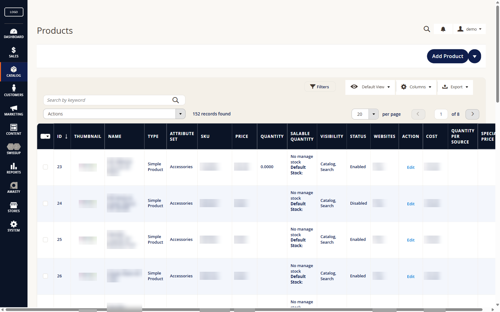

</div>

## Avant / après

La même grille produits, avec l'administration d'origine de Magento puis avec le module.

| Magento d'origine | Avec Maxcode Admin Branding |
|---|---|
| 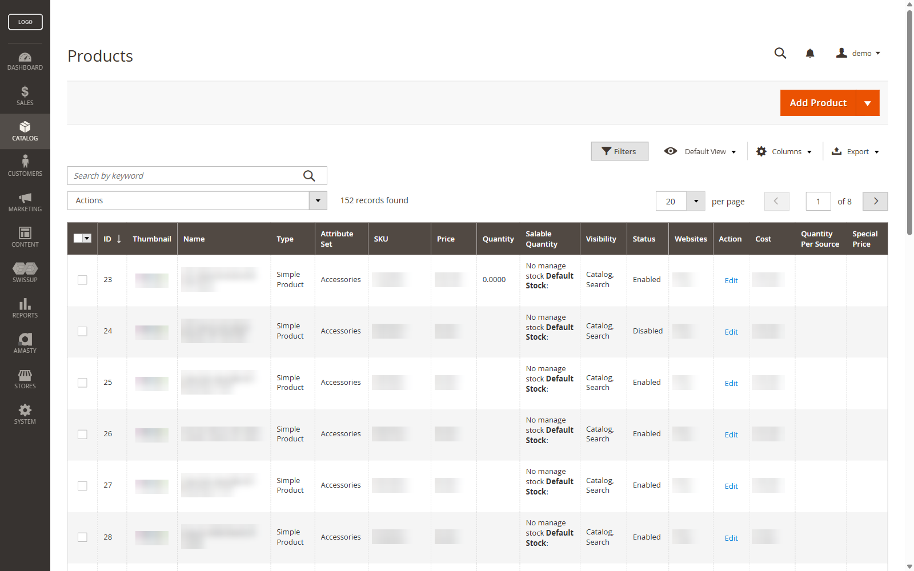 |  |

## Ce que fait le module

- **Un thème complet pour le back-office :** en-tête, menu, grilles, formulaires, boutons, messages et volets latéraux, sur une palette sobre (marine, orange, fond crème).
- **Une page de connexion soignée :** carte centrée avec liseré, votre logo, fond sombre.
- **Votre logo et votre favicon** dans l'administration, réglables depuis la configuration (le favicon accepte le format ICO, que Magento refuse d'ordinaire).
- **Aucune surcharge de template, ni `preference`, ni plugin :** une feuille de style et trois petits blocs de mise en page. Le désactiver rend l'administration de Magento telle quelle.
- **Lisibilité soignée,** jusque dans les cas limites : options sélectionnées, champs désactivés, cases à cocher.
- **Traduit** en français et en anglais.

| Page de connexion | Tableau de bord |
|---|---|
| 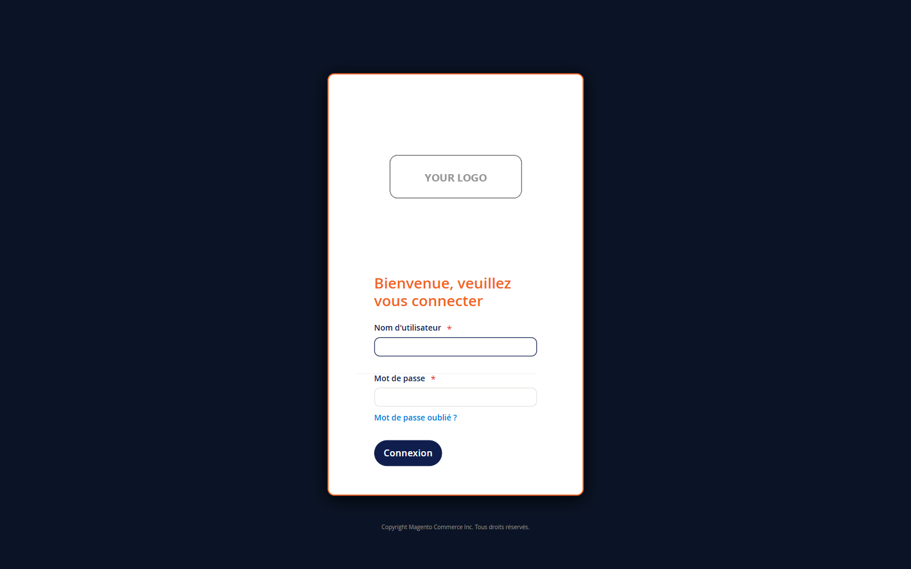 | 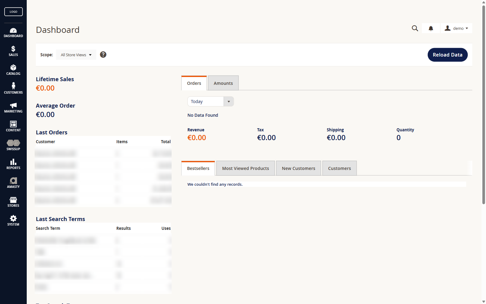 |

| Fiche produit | Logo et favicon |
|---|---|
| 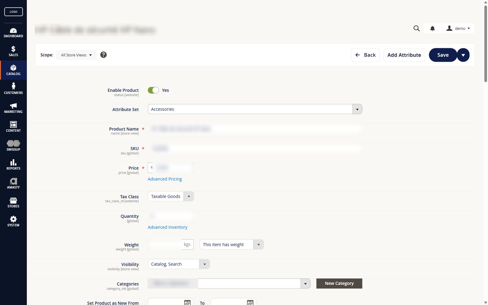 | 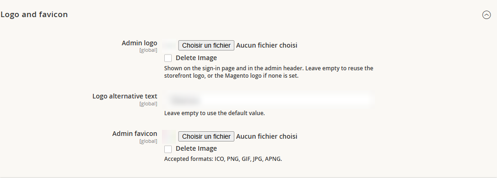 |

Réglages : **Magasins > Configuration > Maxcode > Thème Administration**.

## Installation

```bash
composer config repositories.maxcode-admin-branding vcs https://github.com/eBusiness360/module-admin-branding
composer require maxcode/module-admin-branding
bin/magento setup:upgrade
bin/magento setup:di:compile
bin/magento setup:static-content:deploy -f --area adminhtml
bin/magento cache:flush
```

Prérequis : Magento Open Source ou Adobe Commerce 2.4.x, PHP 8.2 ou plus.

---

## Allez plus loin avec Admin Branding **PRO**

Le module gratuit donne à l'administration le thème Maxcode. **PRO** en fait **le vôtre**, depuis l'écran de configuration, sans une ligne de code.

| Fonctionnalité | Gratuit | PRO |
|---|:---:|:---:|
| Thème Maxcode du back-office | ✓ | ✓ |
| Page de connexion habillée, logo et favicon | ✓ | ✓ |
| **Vos couleurs** : 13 réglages, de l'en-tête aux messages d'erreur | | ✓ |
| **Formes** : style Maxcode, Magento d'origine ou rayons et bordures sur mesure | | ✓ |
| **Police Google Fonts** choisie avec aperçu en direct | | ✓ |
| **Page de maintenance** à vos couleurs, dans la langue de chaque vue magasin | | ✓ |
| Crédit éditeur masquable en pied de page | | ✓ |

### Vos couleurs, votre police, vos formes

Le même back-office avec une palette, une police et des formes réglées en quelques clics :

| Grille produits | Page de connexion |
|---|---|
| 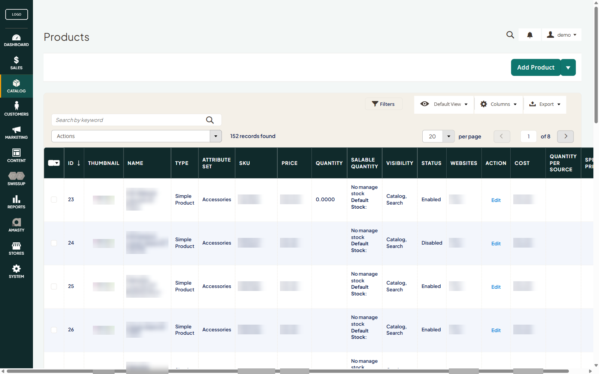 | 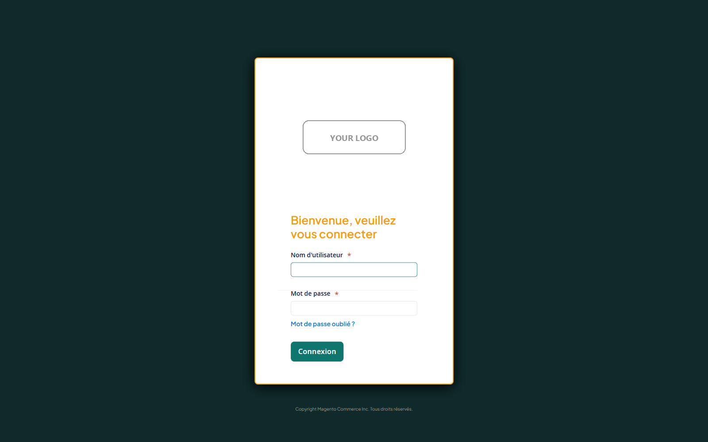 |

| Couleurs | Formes | Police avec aperçu |
|---|---|---|
| 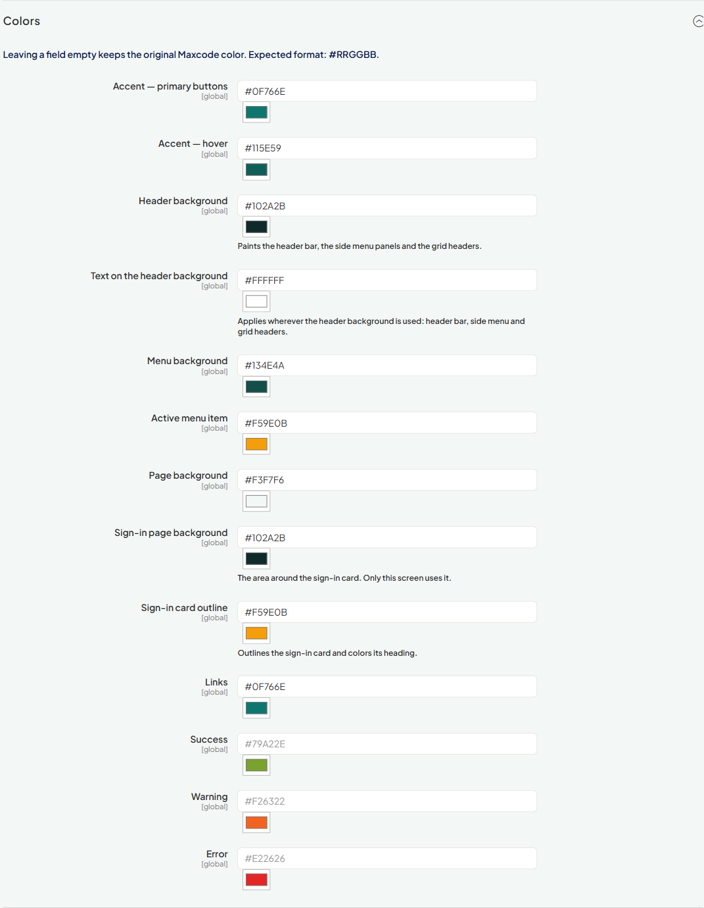 | 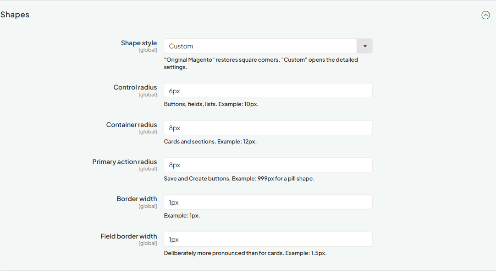 | 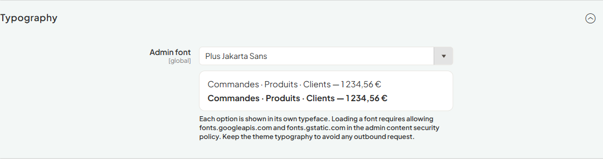 |

### Une page de maintenance qui rassure vos clients

Pendant `bin/magento maintenance:enable`, Magento affiche une page brute. PRO la remplace par une page aux couleurs de votre administration :
- votre logo ;
- un message dans la langue de la vue magasin, réglable par vue ;
- vos coordonnées ;
- un affichage soigné sur mobile.

La page est générée à l'avance. Pendant la maintenance, rien ne dépend de Magento.

| Ordinateur | Mobile |
|---|---|
| 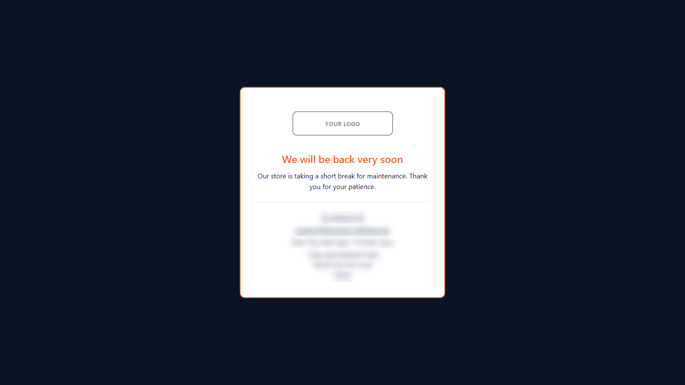 |  |

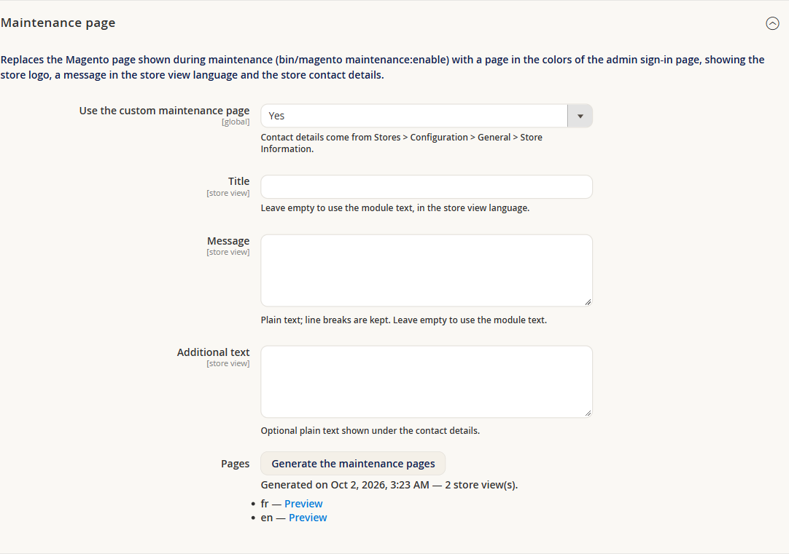

<div align="center">

### [→ Obtenir Admin Branding PRO](https://www.ebusiness360.fr/contact/)

S'installe par-dessus le module gratuit, via Composer. Contactez-nous pour un devis.

</div>

---

## Pour les développeurs : contrat des variables CSS

Ce module n'écrit **jamais** `:root { --mx-admin-*: … }`. Chaque règle de
`view/adminhtml/web/css/admin-theme.css` lit sa variable avec une valeur de repli :

```css
background: var(--mx-admin-accent, #0F1E4D);
```

Un module tiers — `Maxcode_AdminBrandingPro`, ou tout autre — prend la main en
définissant ces variables dans le `<head>` de l'administration. Une variable
définie l'emporte toujours sur un repli, quel que soit l'ordre de chargement.

Ces noms constituent une interface publique : ils ne changent pas sans montée
de version majeure.

### Couleurs

| Variable | Repli | Rôle |
|---|---|---|
| `--mx-admin-accent` | `#0F1E4D` | fond des boutons primaires |
| `--mx-admin-accent-hover` | `#0B1426` | survol de l'accent |
| `--mx-admin-on-accent` | *(voir ci-dessous)* | texte posé sur le fond d'accentuation : libellé des boutons primaires. **Non définie par défaut** : retombe sur `--mx-admin-header-text`, puis sur `#FFFFFF`. |
| `--mx-admin-header-bg` | `#0B1426` | fond de la barre d'en-tête, du menu latéral et des **en-têtes de grille** |
| `--mx-admin-header-text` | `#FFFFFF` | texte posé sur `--mx-admin-header-bg` : en-tête, menu, en-têtes de grille. Sert aussi de repli à `--mx-admin-on-accent` et `--mx-admin-on-check`. |
| `--mx-admin-menu-bg` | `#0F1E4D` | menu latéral |
| `--mx-admin-menu-active` | `#F26322` | entrée de menu active |
| `--mx-admin-page-bg` | `#FAF8F4` | fond de page |
| `--mx-admin-login-bg` | `#0B1426` | fond de la page de connexion, derrière la carte |
| `--mx-admin-login-frame` | `#F26322` | liseré de la carte de connexion et titre « Bienvenue… » |
| `--mx-admin-surface-muted` | `#F4F0E8` | surfaces secondaires (navigation de configuration, barres de grille, en-têtes de modale) |
| `--mx-admin-surface-alt` | `#F3F6FC` | lignes alternées des grilles (bleu très clair) |
| `--mx-admin-menu-label` | `#8891A8` | intitulés de groupe du sous-menu |
| `--mx-admin-submenu-link` | `#D7DCE8` | entrées du sous-menu |
| `--mx-admin-text` | `#0F1E4D` | couleur de texte générale, posée sur `body` et héritée par tout ce qui ne fixe pas la sienne |
| `--mx-admin-check` | `#1E4FA3` | fond des cases à cocher cochées |
| `--mx-admin-on-check` | *(voir ci-dessous)* | glyphe posé sur `--mx-admin-check`. **Non définie par défaut** : retombe sur `--mx-admin-header-text`, puis sur `#FFFFFF`. |
| `--mx-admin-link` | `#1E4FA3` | liens |
| `--mx-admin-success` | `#79A22E` | succès |
| `--mx-admin-success-bg` | `#EDF7EC` | fond des messages de succès |
| `--mx-admin-success-border` | `#CFE6C2` | cadre des messages de succès |
| `--mx-admin-success-text` | `#3F6B12` | texte des pastilles de succès |
| `--mx-admin-warning` | `#F26322` | alerte |
| `--mx-admin-warning-bg` | `#FDF4E7` | fond des messages d'alerte |
| `--mx-admin-warning-border` | `#F0DCC0` | cadre des messages d'alerte |
| `--mx-admin-warning-text` | `#8A3410` | texte sur fond d'alerte |
| `--mx-admin-error` | `#E22626` | erreur |
| `--mx-admin-error-bg` | `#FBEDED` | fond des messages d'erreur |
| `--mx-admin-error-border` | `#EFC9C9` | cadre des messages d'erreur |
| `--mx-admin-error-text` | `#A31A1A` | texte des pastilles d'erreur |

#### Les deux variables « posé sur » : `--mx-admin-on-accent` et `--mx-admin-on-check`

Ces deux-là sont les seules du tableau qui n'ont **pas** de repli littéral : elles
retombent sur une autre variable.

```css
color: var(--mx-admin-on-accent, var(--mx-admin-header-text, #FFFFFF));
```

Aucune règle de ce module ne les définit. Tant qu'un module tiers ne les pose pas,
elles se comportent donc exactement comme `--mx-admin-header-text` — c'est
volontaire, et c'est ce qui rend leur introduction sans effet sur le rendu.

Elles existent parce que ces deux textes ne sont **pas** posés sur le fond
d'en-tête : le libellé d'un bouton primaire est posé sur `--mx-admin-accent`, le
glyphe d'une case cochée sur `--mx-admin-check`. Qui repeint l'un de ces deux
fonds peut désormais corriger le texte correspondant sans toucher à l'en-tête, et
qui éclaircit son en-tête ne noircit plus le libellé de tous les boutons
primaires de l'administration.

### Formes

| Variable | Repli | Rôle |
|---|---|---|
| `--mx-admin-radius-control` | `10px` | boutons, champs, listes |
| `--mx-admin-radius-surface` | `12px` | conteneurs, cartes |
| `--mx-admin-radius-pill` | `999px` | boutons d'action principale |
| `--mx-admin-border-width` | `1px` | bordures de conteneur |
| `--mx-admin-border-width-field` | `1.5px` | bordures de champ |
| `--mx-admin-border-color` | `#E5E2DC` | bordures |
| `--mx-admin-border-color-soft` | `#F0EDE7` | séparateurs |
| `--mx-admin-surface` | `#FFFFFF` | fond des conteneurs |
| `--mx-admin-shadow` | `none` | ombres |
| `--mx-admin-grid-head-pad` | `1.4rem` | rembourrage vertical des en-têtes de grille. La position de la case « tout sélectionner » des anciennes grilles en dépend par calcul : la changer déplace les deux ensemble. |

### Typographie

Ces trois variables sont les leviers les plus globaux du module : elles s'appliquent
sur `body`, donc par héritage à **tout** le back-office, y compris les écrans des
extensions tierces.

| Variable | Repli | Rôle |
|---|---|---|
| `--mx-admin-font` | `'Open Sans', 'Helvetica Neue', Helvetica, Arial, sans-serif` | famille typographique. Le repli reprend la pile du thème admin : il ne change donc rien tant qu'on ne le redéfinit pas. |
| `--mx-admin-font-weight` | `600` | graisse du texte courant |
| `--mx-admin-font-weight-strong` | `700` | graisse des libellés et des titres |

**Magento n'embarque Open Sans qu'en 300, 400, 600 et 700.** Toute autre valeur fait
retomber le navigateur sur la graisse voisine, sans effet visible.

---

## Licence et éditeur

Module gratuit distribué sous le [contrat de licence utilisateur final](LICENSE) de
Maxcode (gratuit, propriétaire). Édité par
[eBusiness360](https://www.ebusiness360.fr/) — Maxime Lesguillier aka Maxcode.

*Les captures sont prises sur une boutique réelle : logos, noms de produits,
prix et coordonnées y sont volontairement masqués.*
