<div align="center">

**English** · [Français](README.fr.md)

# Maxcode Admin Branding for Magento 2

**A clean, modern Magento 2 admin: free, no template overrides, uninstalls without a trace.**


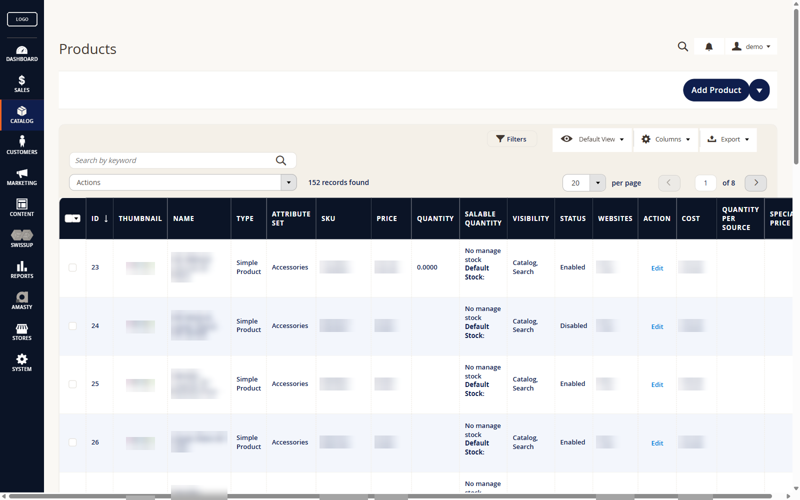

</div>

## Before / after

The same product grid, in the stock Magento admin and with the module.

| Stock Magento | With Maxcode Admin Branding |
|---|---|
| 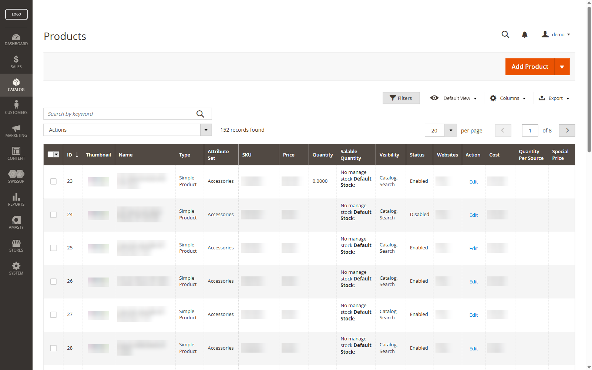 |  |

## What it does

- **A complete back-office theme:** header, menu, grids, forms, buttons, messages and slide-out panels, on a calm palette (navy, orange, cream background).
- **A polished sign-in page:** centred card with an outline, your logo, dark background.
- **Your logo and favicon** in the admin, set from the configuration (the favicon accepts ICO files, which Magento normally rejects).
- **No template override, no `preference`, no plugin:** one stylesheet and three small layout blocks. Disable it and you get the stock Magento admin back.
- **Careful readability,** down to the edge cases: selected options, disabled fields, checkboxes.
- **Translated** into English and French.

| Sign-in page | Dashboard |
|---|---|
| 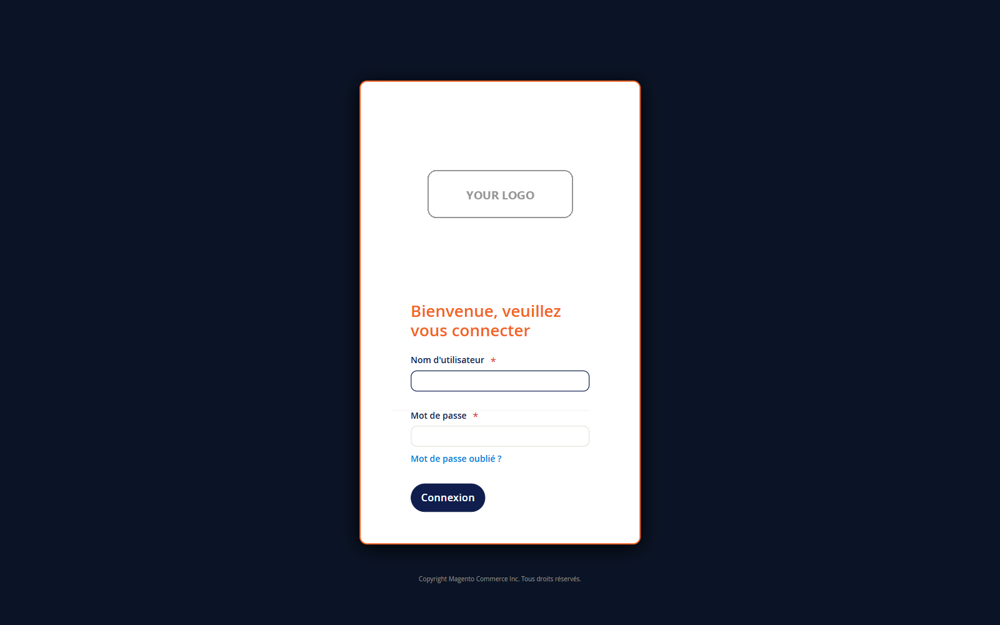 | 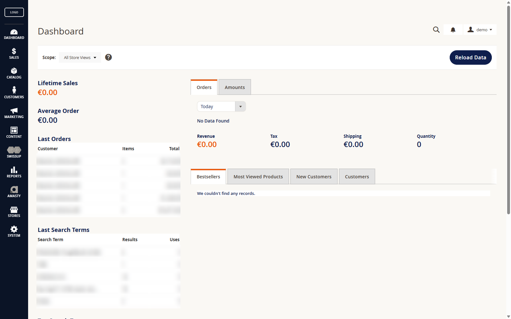 |

| Product form | Logo and favicon |
|---|---|
| 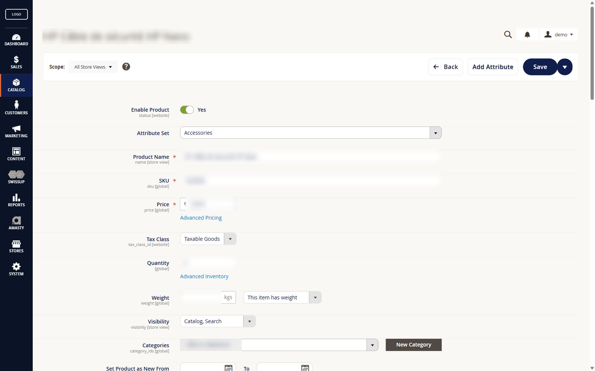 | 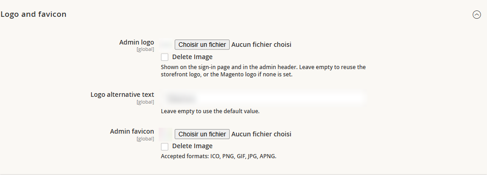 |

Settings: **Stores > Configuration > Maxcode > Admin Theme**.

## Installation

```bash
composer config repositories.maxcode-admin-branding vcs https://github.com/eBusiness360/module-admin-branding
composer require maxcode/module-admin-branding
bin/magento setup:upgrade
bin/magento setup:di:compile
bin/magento setup:static-content:deploy -f --area adminhtml
bin/magento cache:flush
```

Requirements: Magento Open Source or Adobe Commerce 2.4.x, PHP 8.2 or later.

---

## Go further with Admin Branding **PRO**

The free module gives your admin the Maxcode theme. **PRO** makes it **yours**, from the configuration screen, without writing a line of code.

| Feature | Free | PRO |
|---|:---:|:---:|
| Maxcode back-office theme | ✓ | ✓ |
| Styled sign-in page, logo and favicon | ✓ | ✓ |
| **Your colours**: 13 settings, from the header to error messages | | ✓ |
| **Shapes**: Maxcode style, stock Magento, or custom radii and borders | | ✓ |
| **Google Fonts typeface** picked with a live preview | | ✓ |
| **Maintenance page** in your colours, in each store view's language | | ✓ |
| Hide the publisher credit in the footer | | ✓ |

### Your colours, your typeface, your shapes

The same back office with a palette, a typeface and shapes set in a few clicks:

| Product grid | Sign-in page |
|---|---|
| 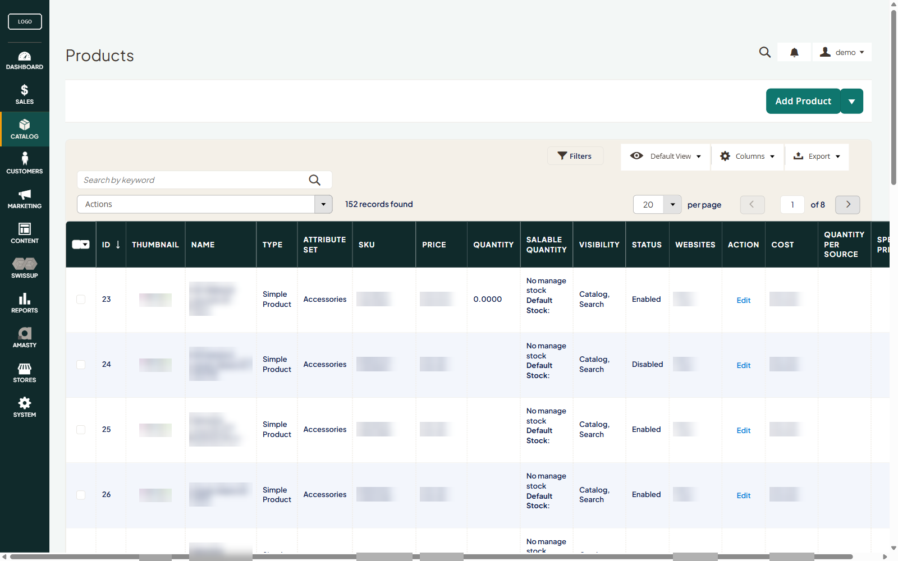 | 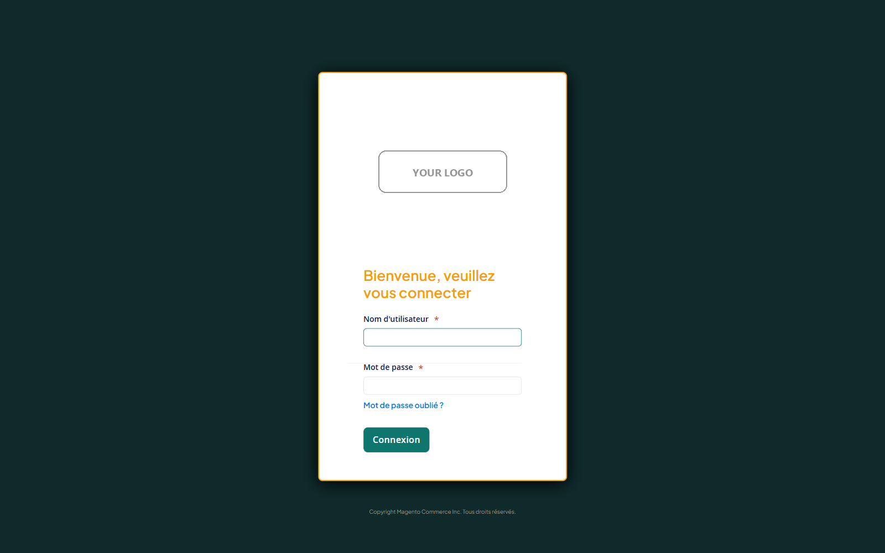 |

| Colours | Shapes | Typeface with preview |
|---|---|---|
| 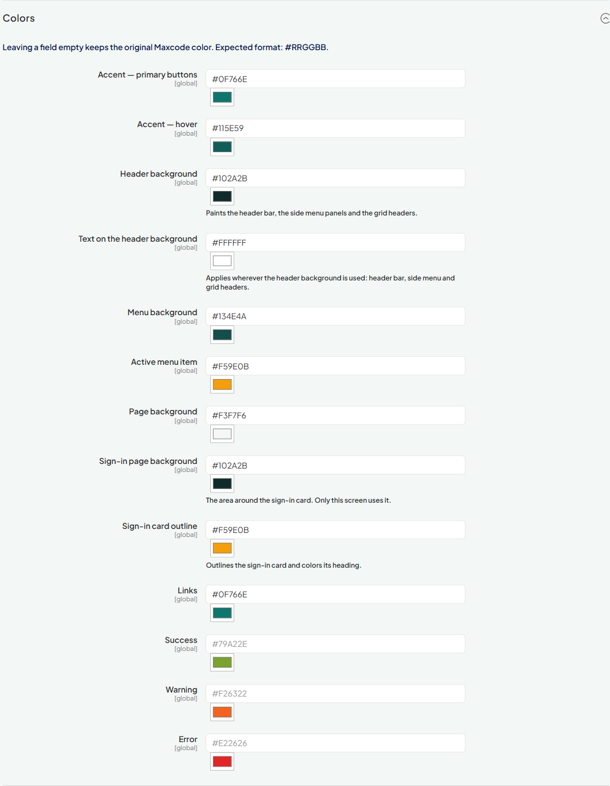 | 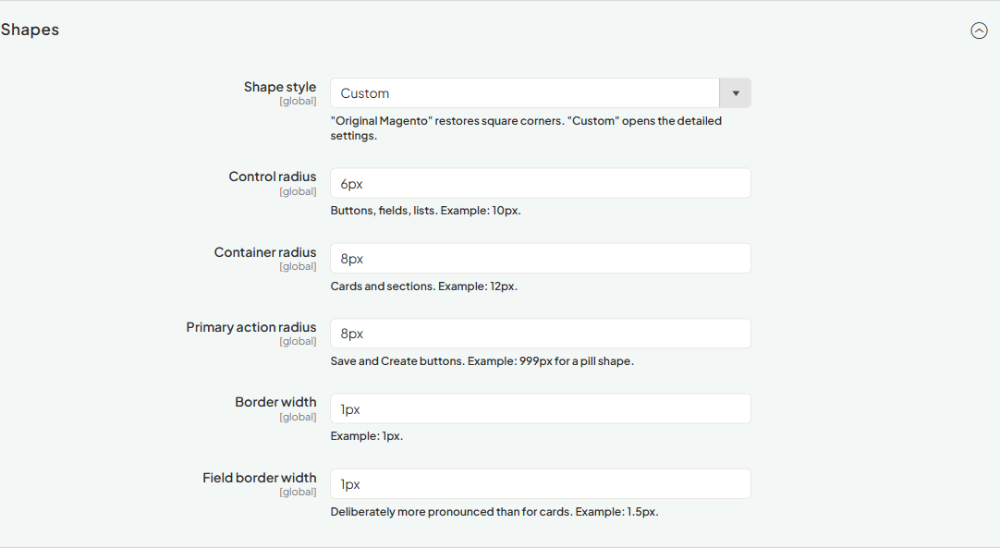 | 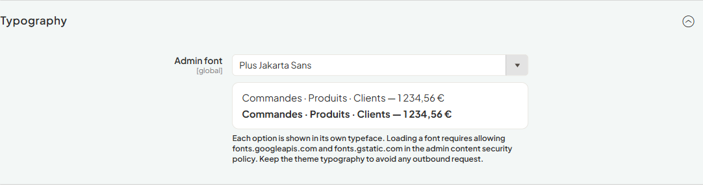 |

### A maintenance page that reassures your customers

During `bin/magento maintenance:enable`, Magento shows a bare page. PRO replaces it with a page in your admin's colours:
- your logo;
- a message in the store view's language, editable per view;
- your contact details;
- a clean layout on mobile.

The page is generated ahead of time. While in maintenance, nothing depends on Magento.

| Desktop | Mobile |
|---|---|
| 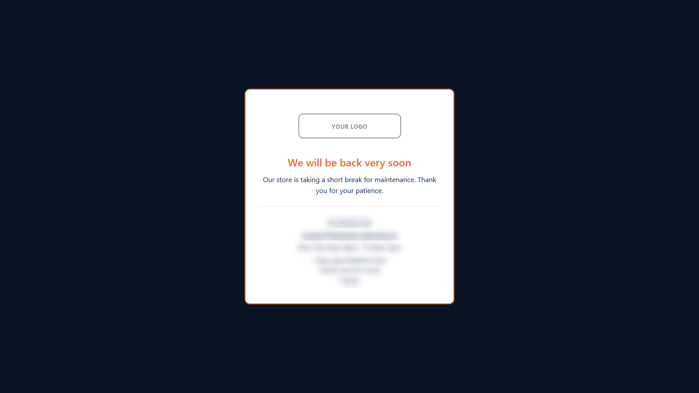 | 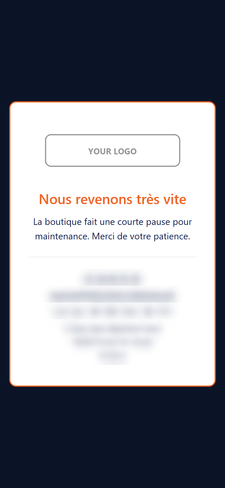 |

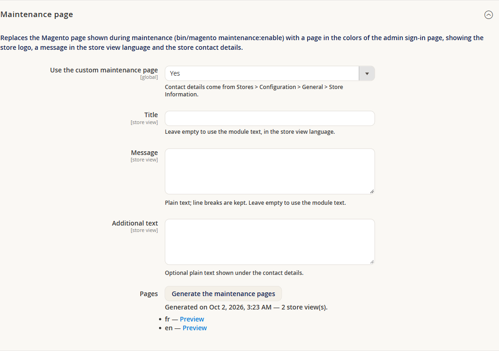

<div align="center">

### [→ Get Admin Branding PRO](https://www.ebusiness360.fr/contact/)

Installs on top of the free module, with Composer. Contact us for a quote.

</div>

---

## For developers: the CSS variable contract

This module **never** writes `:root { --mx-admin-*: … }`. Every rule in
`view/adminhtml/web/css/admin-theme.css` reads its variable with a fallback value:

```css
background: var(--mx-admin-accent, #0F1E4D);
```

A third-party module — `Maxcode_AdminBrandingPro` or any other — takes over by
defining these variables in the admin `<head>`. A defined variable always wins
over a fallback, whatever the loading order.

These names are a public interface: they don't change without a major version
bump.

### Colours

| Variable | Fallback | Role |
|---|---|---|
| `--mx-admin-accent` | `#0F1E4D` | primary button background |
| `--mx-admin-accent-hover` | `#0B1426` | accent hover |
| `--mx-admin-on-accent` | *(see below)* | text on the accent background: primary button labels. **Not defined by default**: falls back to `--mx-admin-header-text`, then `#FFFFFF`. |
| `--mx-admin-header-bg` | `#0B1426` | header bar, side menu panels and **grid headers** background |
| `--mx-admin-header-text` | `#FFFFFF` | text on `--mx-admin-header-bg`: header, menu, grid headers. Also the fallback of `--mx-admin-on-accent` and `--mx-admin-on-check`. |
| `--mx-admin-menu-bg` | `#0F1E4D` | side menu |
| `--mx-admin-menu-active` | `#F26322` | active menu item |
| `--mx-admin-page-bg` | `#FAF8F4` | page background |
| `--mx-admin-login-bg` | `#0B1426` | sign-in page background, behind the card |
| `--mx-admin-login-frame` | `#F26322` | sign-in card outline and "Welcome…" heading |
| `--mx-admin-surface-muted` | `#F4F0E8` | secondary surfaces (configuration navigation, grid toolbars, modal headers) |
| `--mx-admin-surface-alt` | `#F3F6FC` | alternate grid rows (very light blue) |
| `--mx-admin-menu-label` | `#8891A8` | submenu group titles |
| `--mx-admin-submenu-link` | `#D7DCE8` | submenu entries |
| `--mx-admin-text` | `#0F1E4D` | general text colour, set on `body` and inherited by everything that doesn't set its own |
| `--mx-admin-check` | `#1E4FA3` | checked checkbox background |
| `--mx-admin-on-check` | *(see below)* | glyph on `--mx-admin-check`. **Not defined by default**: falls back to `--mx-admin-header-text`, then `#FFFFFF`. |
| `--mx-admin-link` | `#1E4FA3` | links |
| `--mx-admin-success` | `#79A22E` | success |
| `--mx-admin-success-bg` | `#EDF7EC` | success message background |
| `--mx-admin-success-border` | `#CFE6C2` | success message border |
| `--mx-admin-success-text` | `#3F6B12` | success badge text |
| `--mx-admin-warning` | `#F26322` | warning |
| `--mx-admin-warning-bg` | `#FDF4E7` | warning message background |
| `--mx-admin-warning-border` | `#F0DCC0` | warning message border |
| `--mx-admin-warning-text` | `#8A3410` | text on a warning background |
| `--mx-admin-error` | `#E22626` | error |
| `--mx-admin-error-bg` | `#FBEDED` | error message background |
| `--mx-admin-error-border` | `#EFC9C9` | error message border |
| `--mx-admin-error-text` | `#A31A1A` | error badge text |

#### The two "on" variables: `--mx-admin-on-accent` and `--mx-admin-on-check`

These are the only two in the table **without** a literal fallback: they fall
back to another variable.

```css
color: var(--mx-admin-on-accent, var(--mx-admin-header-text, #FFFFFF));
```

No rule in this module defines them. Until a third-party module sets them, they
behave exactly like `--mx-admin-header-text` — on purpose, which is why adding
them changed nothing on screen.

They exist because these two texts do **not** sit on the header background: a
primary button label sits on `--mx-admin-accent`, a checked box glyph on
`--mx-admin-check`. Whoever repaints one of these backgrounds can now fix the
matching text without touching the header, and lightening the header no longer
darkens every primary button label in the admin.

### Shapes

| Variable | Fallback | Role |
|---|---|---|
| `--mx-admin-radius-control` | `10px` | buttons, fields, lists |
| `--mx-admin-radius-surface` | `12px` | containers, cards |
| `--mx-admin-radius-pill` | `999px` | primary action buttons |
| `--mx-admin-border-width` | `1px` | container borders |
| `--mx-admin-border-width-field` | `1.5px` | field borders |
| `--mx-admin-border-color` | `#E5E2DC` | borders |
| `--mx-admin-border-color-soft` | `#F0EDE7` | separators |
| `--mx-admin-surface` | `#FFFFFF` | container background |
| `--mx-admin-shadow` | `none` | shadows |
| `--mx-admin-grid-head-pad` | `1.4rem` | vertical padding of grid headers. The position of the legacy grids' "select all" box is computed from it: changing it moves both together. |

### Typography

These three variables are the module's most global levers: they apply to `body`,
so by inheritance to **the whole** back office, third-party extension screens
included.

| Variable | Fallback | Role |
|---|---|---|
| `--mx-admin-font` | `'Open Sans', 'Helvetica Neue', Helvetica, Arial, sans-serif` | font family. The fallback is the admin theme's own stack, so nothing changes until you redefine it. |
| `--mx-admin-font-weight` | `600` | body text weight |
| `--mx-admin-font-weight-strong` | `700` | label and heading weight |

**Magento only ships Open Sans in 300, 400, 600 and 700.** Any other value makes
the browser fall back to the nearest weight, with no visible effect.

---

## License and publisher

Free module distributed under Maxcode's [end-user license agreement](LICENSE)
(free, proprietary). Published by
[eBusiness360](https://www.ebusiness360.fr/) — Maxime Lesguillier aka Maxcode.

*Screenshots come from a live store: logos, product names, prices and contact
details are deliberately masked.*
